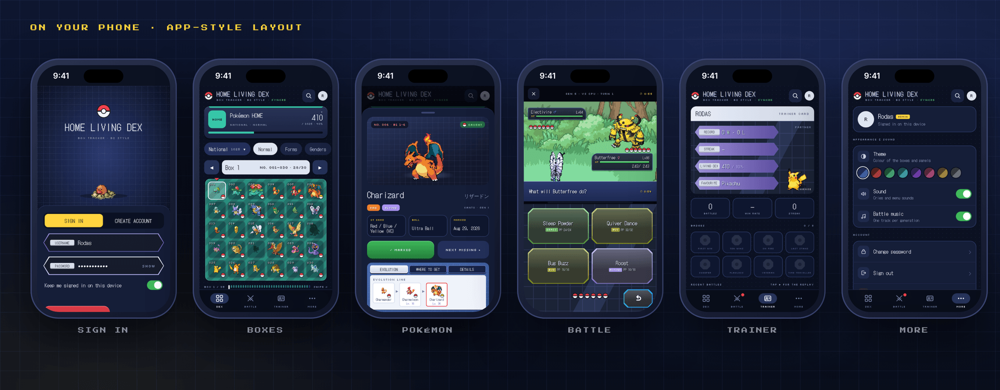
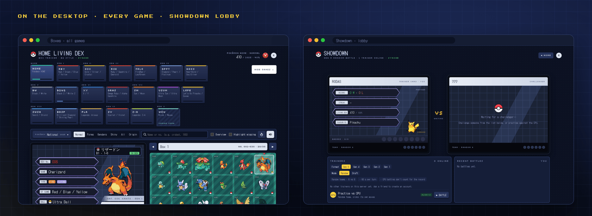
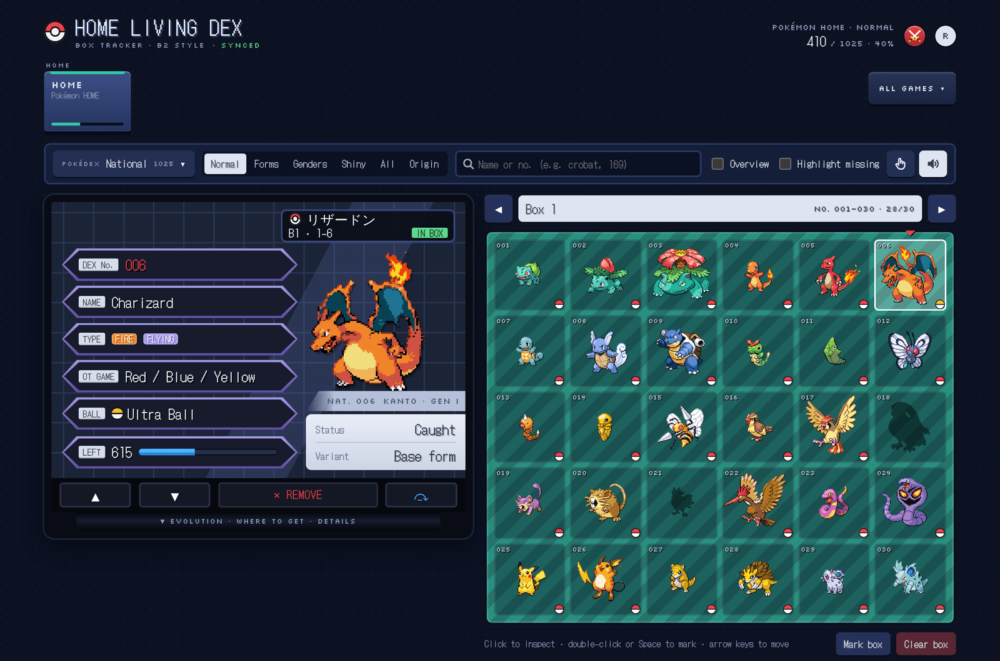

<p align="center">
  
</p>

<h1 align="center">HOME Living Dex</h1>

<p align="center">
  A self-hosted <b>living dex tracker</b> for Pokémon HOME and every mainline game, dressed as the Black 2 summary screen,<br>
  with a built-in <b>Pokémon Showdown</b> arena for Gen 1–5 random and draft battles.
</p>

<p align="center">
  
  
  
  
  
</p>

<p align="center">
  <a href="#features">Features</a> ·
  <a href="#screenshots">Screenshots</a> ·
  <a href="#quick-start-docker">Quick start</a> ·
  <a href="#development">Development</a> ·
  <a href="#design-mocks">Design mocks</a> ·
  <a href="#api">API</a>
</p>

---

## Features

**Living dex tracker**

- All **1025** Pokémon in boxes of 30, with every form, gender difference, shiny and origin-mark variant, for **Pokémon HOME and every game from Red/Blue to Legends: Z-A** (plus the upcoming Gen X, marked *soon*).
- Click to inspect, double-click (or Space) to mark, arrow keys to move. Record the **OT game, ball and date** for each catch; the evolution line, where to get it and the details sit under the summary.
- **Overview** shows every Pokémon in colour; **Highlight missing** makes the gaps stand out; search by name or number from anywhere.
- **Accounts and sync** – everyone has their own dex, saved in SQLite and synced across devices, with a 200-revision history you can restore.
- **Themes** – eight colours for the boxes and panels, sound effects and cries.

**Showdown arena**

- Random battles in **Gen 1 to Gen 5** against the other trainers on your server or the CPU, simulated by the real [Pokémon Showdown](https://github.com/smogon/pokemon-showdown) engine.
- **Draft mode** – a pool of 16 sets, snake picks, then pick your lead.
- **One look per generation** – Red/Blue on a white Game Boy screen, Silver, Ruby/Sapphire on the GBA fields, Diamond/Pearl, and the animated Black/White sprites, each with its own HP boxes, text and wording.
- **Battle music** from each generation, **930+ move animations**, weather, crits and super-effective shakes.
- Trainer cards with record, streak, **eight badges**, a partner Pokémon and **replays** of every battle. Spectators can watch live.

**Built to self-host**

- One container (ASP.NET Core + Node.js for the simulator), one volume, made for a Synology NAS.
- Sprites, cries, backgrounds and music are cached on first use; the admin can **download all assets** in one go.
- **Phone layout** – an app-style design under 700 px (tab bar, swipeable boxes, sheets, full-screen battles); the desktop design is untouched.

## Screenshots

### One look per generation


### Draft mode


### On your phone


### On the desktop


<details>
<summary>The box screen at full size</summary>

</details>

## Quick start (Docker)

```bash
git clone <this repo> livingdex && cd livingdex
docker compose up -d --build
# open http://<server>:8085
```

Open the page and create the first account: it becomes the **admin**. Everyone else creates their own account, then you close sign-up.

Data lives in the `livingdex-data` volume (`/data` in the container): `livingdex.db`, `keys/` (the keys that sign login cookies) and `cache/`. Never run `docker compose down -v`, which deletes that volume.

Settings go in a `.env` file next to `docker-compose.yml`:

```
LIVINGDEX_ALLOW_REGISTRATION=false   # after everyone has an account
LIVINGDEX_BEHIND_PROXY=true          # if Synology's reverse proxy / nginx / Traefik is in front
LIVINGDEX_TURN_SECONDS=60            # time per battle turn
LIVINGDEX_SHOWDOWN=true              # false turns the battle room off
```

With sign-up closed, the admin can still help people from **Manage users** (reset a forgotten password, delete an account).

**Synology:** in *Container Manager → Project*, create a project from this folder (it picks up `docker-compose.yml`). If you put it behind *Login Portal → Advanced → Reverse Proxy*, open the rule's *Custom Header* tab and choose *Create → WebSocket* so battles use WebSockets (they fall back to long polling otherwise), and set `LIVINGDEX_BEHIND_PROXY=true`. In Nginx Proxy Manager, tick **Websockets Support**.

If you bind-mount a host folder instead of the named volume, make it writable by UID 1654 (the `app` user of the .NET images):

```bash
mkdir -p ./data && sudo chown 1654 ./data
```

### Upgrading from the single-user version

- `LIVINGDEX_API_KEY` is no longer used; accounts replace it. You can remove it from `.env`.
- Nothing is lost: the old progress and history stay in the database until the first account is created, which then receives them.

If you bind-mount a host folder instead of the named volume, make it writable by UID 1654 (the `app` user of the .NET images):

```bash
mkdir -p ./data && sudo chown 1654 ./data
```

## On a phone

Screens up to 700 px wide get a layout of their own (the PC one doesn't change): a tab bar at the bottom (Dex · Battle · Trainer · More), the game you track as one card (tap it for the game list), the variants as chips that scroll sideways, the box at full width (swipe to change boxes) and sheets that slide up for a Pokémon's details, the game list and the Pokédex. Battles go full screen, with the touch screen taking the rest of the height. Trainer shows your card, badges and battles with their replays; More has the theme, sound and music, your account, the admin tools and the backup. Add it to the home screen for an app icon.

## Download all assets

Sprites, cries, battle backgrounds and music are fetched the first time someone needs them and kept in `data/cache`. To get everything in one go, open the account menu as the admin and choose **Download all assets**: the server downloads every sprite (box, animated, shiny, female, back, icons and the Gen 1–4 battle sprites), every cry, the battle effects and backgrounds and the battle music, about 16,000 files and a few hundred MB, in the background with a progress bar. You can close the page while it runs. Files already cached are skipped, so running it again later only fetches what is new.

## Showdown in detail

The crossed-swords button in the header opens the battle room. Each battle gives both players a random team of six (Pokémon Showdown's random battle sets) in the chosen generation, Gen 1 to Gen 5.

- **Lobby** – your trainer card (record, win streak, living dex count from Pokémon HOME · Normal, and a partner Pokémon you pick from your living dex), the other trainers with their status, and your recent battles.
- **Challenges** – challenge anyone who is online. They see a pop-up wherever they are in the app (and a yellow number on the battle button) and can accept or decline. Challenges expire after 90 seconds.
- **Battle** – the Black 2 style top screen with a random battlefield, and FIGHT / POKÉMON / INFO / FORFEIT below. You can switch mid-battle, and you choose who comes in when one faints. Each turn has a timer (60 s by default). When it runs out the game picks a move for you, and after three timeouts in a row you forfeit.
- **Reconnects** – closing the tab or losing the connection doesn't end the battle. Open the page again and you are back where you were.
- **Watching and replays** – anyone signed in can watch a battle in progress, and every finished battle can be replayed from the result screen or the recent-battles list.
- **CPU** – practice battles against a simple AI that picks strong moves and switches out of bad match-ups. They don't count for the win/loss record.
- **Battle effects** – every move plays its Pokémon Showdown animation (930+ moves, with Showdown's effect sprites), the screen flashes in the move's type colour, super-effective hits shake the screen, critical hits flash white, stat changes and status conditions have their own effects, and rain, sun, sandstorm and hail stay on screen while they last. A LOG button on the bottom screen lists every turn.
- **Draft mode** – in the lobby, under Format, pick the Mode: **Random** (six random Pokémon each) or **Draft**. In a draft, the server rolls a pool of 16 random-battle Pokémon of that generation with their sets (moves, ability, item, level). The two trainers pick in a snake (1 · 2 2 · 1 1 · …) until each has six, 30 seconds per pick (time out = a random pick). Tap a Pokémon on the bottom screen to see its set on the top screen. Then both choose their lead and the battle starts. Against the CPU it works too: the CPU takes the strongest set left. Spectators can watch the draft.
- **A look for each generation** – Gen 1 battles use the Pokémon Red/Blue sprites on a plain white Game Boy screen, Gen 2 the Silver sprites, Gen 3 Ruby/Sapphire on the GBA fields, Gen 4 Diamond/Pearl on the DS fields, and Gen 5 the animated Black/White sprites. The HP boxes, text box and wording ("Enemy GENGAR", "Foe GENGAR", "The foe's GENGAR") follow each era. Gen 1–2 keep the Game Boy effects (screen shake and blink) instead of the modern move animations. The bottom touch screen is the same in every generation.
- **Battle music** – each battle plays a track from its generation, picked at random and looped: the HGSS Kanto and Johto trainer themes for Gen 1 and 2, Ruby/Sapphire (ORAS), Colosseum and XD for Gen 3, Diamond/Pearl for Gen 4 and Black/White and B2W2 for Gen 5. The ♪ button on the bottom screen turns it off (remembered on that device).
- **Badges** – eight badges on the trainer card, earned in battles against other trainers: First Win, Ten Wins, On Fire (5 in a row), Last Stand (win with 1 Pokémon left), Sweeper (3 KOs with one Pokémon), Flawless (win without losing one), Veteran (50 battles) and Time Traveller (win in Gen 1 to Gen 5).

How it runs: `sim/bridge.js` loads the `pokemon-showdown` npm package and hosts all battles in one Node.js process, which the app starts and supervises (it is restarted if it crashes; battles that were running end as "stopped"). The page talks to the server over SignalR (`/hubs/showdown`): WebSockets if your reverse proxy allows them, long polling otherwise. In Nginx Proxy Manager, tick **Websockets Support** on the proxy host.

Battle backgrounds and move-animation sprites are downloaded once from the [Pokémon Showdown client](https://github.com/smogon/pokemon-showdown-client) repository and cached like the sprites.

## Development

### Repository layout

```
src/LivingDex/              ASP.NET Core app (.NET 10)
  Program.cs                composition root, static files, endpoint mapping
  LivingDexOptions.cs       settings
  Auth/                     accounts: password hashing, cookie login, admin endpoints, CSRF header check
  Data/                     SQLite connection, schema, write lock
  State/                    progress repository (Dapper) and endpoints
  Assets/                   sprite/cry/background/music cache and the "download all" prefetcher
  Showdown/                 battles: simulator process, live state, draft, SignalR hub, history, trainer cards
  sim/                      bridge.js + package.json for the Pokémon Showdown simulator (Node.js)
  wwwroot/index.html        the whole web client, built from client/ (do not edit by hand)
  wwwroot/lib/              SignalR client, jQuery, move animations (psanims.js, psfx.js)
tests/LivingDex.Tests/      WebApplicationFactory API tests
client/
  assemble.py               builds wwwroot/index.html from client/src
  src/                      base.html (base styles), body.html, app.js (tracker), sd.js (Showdown),
                            mob.js (phone layer), *.css, icons.py, data2.json (generated Pokédex data)
  psfx/                     move-animation sources + build.sh (esbuild bundle → wwwroot/lib)
tools/data/                 build_data.py: PokeAPI CSVs + Showdown data → client/src/data2.json
docs/                       README images and the HTML design mocks
```

### Run locally

```bash
(cd src/LivingDex/sim && npm ci --omit=optional --ignore-scripts)   # battle simulator (Node.js 18+)
dotnet run --project src/LivingDex        # http://localhost:5080
dotnet test                               # API tests
```

Requires the .NET 10 SDK. Without Node.js the tracker works as usual and the battle button stays hidden.

### Change the web client

The page is a single self-contained HTML file. Edit the pieces in `client/src`, then rebuild it:

```bash
python3 client/assemble.py      # → src/LivingDex/wwwroot/index.html
```

`assemble.py` concatenates the stylesheets in a fixed order (base → tracker → Showdown → generations → draft → toolbar → phone), recolours the blue hues into `hsl(var(--h) …)` so the theme picker can tint them, and inlines `data2.json`, `app.js`, `sd.js` and `mob.js`. Everything for phones lives in `mob.css` (inside `@media (max-width:700px)`) and `mob.js`, so desktop changes and phone changes stay apart.

### Rebuild the Pokédex data

```bash
python3 tools/data/build_data.py   # → client/src/data2.json, then run client/assemble.py
```

It reads the [PokeAPI](https://github.com/PokeAPI/pokeapi) CSV exports in `tools/data/csv` and Pokémon Showdown's `formats-data`/`pokedex` files in `tools/data/sd` (which decide what exists in each game). Drop in newer copies of those files to update.

### Rebuild the move animations

```bash
client/psfx/build.sh               # needs Node.js; → wwwroot/lib/psanims.js and psfx.js
```

## Design mocks

Every screen was designed as a clickable HTML mock before it was built. The sources are in [`docs/mocks`](docs/mocks) (open them in a browser; most are interactive).

<table>
<tr>
<td colspan="2"><b>Phone app</b> · <a href="docs/mocks/phone-app.html">phone-app.html</a><br></td>
</tr>
<tr>
<td width="50%"><b>A look per generation</b> · <a href="docs/mocks/showdown-generations.html">showdown-generations.html</a><br></td>
<td width="50%"><b>Draft mode</b> · <a href="docs/mocks/showdown-draft.html">showdown-draft.html</a><br></td>
</tr>
<tr>
<td width="50%"><b>Black 2 battle menu</b> · <a href="docs/mocks/battle-menu.html">battle-menu.html</a><br></td>
<td width="50%" valign="top"><b>How the mocks became the app</b><br><br>Mocks use sample data and are drawn at their own size, so they differ in small ways from the finished screens above (for example, the Gen 3 and Gen 4 HP boxes lost their EXP bar, and the lobby's Mode row sits under Format). The <a href="#screenshots">screenshots</a> show the real app.</td>
</tr>
</table>

## Configuration

All settings are under `LivingDex` (env vars use `LivingDex__Name`):

| Setting | Default | Meaning |
|---|---|---|
| `DataDirectory` | `data` | SQLite database and asset cache folder |
| `AllowRegistration` | `true` | Let people create their own account (the first account is always allowed) |
| `BehindProxy` | `false` | Trust `X-Forwarded-For` / `X-Forwarded-Proto` from a reverse proxy |
| `AuthAttemptsPerMinute` | `10` | Sign-in / sign-up / password attempts per minute from one address |
| `HistoryLimit` | `200` | Saved revisions kept for restore |
| `CacheAssets` | `true` | Cache sprites/cries on disk; `false` redirects to GitHub |
| `MaxStateBytes` | `8388608` | Largest accepted progress document |
| `ShowdownEnabled` | `true` | Turn the battle room on or off |
| `TurnSeconds` | `60` | Time per turn in battles (15–600) |
| `NodePath` | `node` | Node.js executable for the simulator |
| `SimDirectory` | `sim` | Folder with `bridge.js` and its `node_modules` |

## API

Every request that changes something must send the header `X-LivingDex: 1` (CSRF protection for the cookie login).

| Method | Path | Notes |
|---|---|---|
| GET | `/api/health` | Always open. `{ status, firstRun, registration, showdown }` |
| POST | `/api/auth/register` | `{ username, password, remember? }` → signs in. 409 if taken, 403 if sign-up is closed |
| POST | `/api/auth/login` | `{ username, password, remember? }` → signs in (cookie `livingdex.auth`) |
| POST | `/api/auth/logout` | |
| GET | `/api/auth/me` | `{ id, username, isAdmin }` or 401 |
| POST | `/api/auth/password` | `{ currentPassword, newPassword }`. Signs out the account's other devices |
| POST | `/api/auth/delete-account` | `{ password }`. Deletes the account and its progress |
| GET | `/api/admin/users` | Admin only. Accounts with marked count and last sign-in |
| POST | `/api/admin/users/{id}/reset-password` | Admin only. Returns `{ temporaryPassword }` |
| DELETE | `/api/admin/users/{id}` | Admin only |
| GET | `/api/state` | Signed-in user's `{ revision, updatedAt, data }` (revision 0 and `data: null` when empty) |
| PUT | `/api/state` | Body `{ revision, data, client? }`. `revision` is the one you loaded; a stale one returns **409** with the current state |
| GET | `/api/history?take=30` | Recent revisions with a count of marked entries |
| POST | `/api/history/{revision}/restore` | Saves that revision again as the newest one |
| GET | `/api/showdown/status` | `{ available, problem, formats, backgrounds, turnSeconds }` |
| GET | `/api/showdown/trainers` | Every trainer card: record, streak, living dex count, partner, last seen |
| PUT | `/api/showdown/me/partner` | `{ partner, shiny }` (national dex number 1–1025) |
| GET | `/api/showdown/battles` | Your 12 most recent battles |
| GET | `/api/showdown/battles/{id}` | One battle with teams and the full log, for replays |
| WS | `/hubs/showdown` | SignalR hub: presence, challenges, battle messages and choices |
| GET | `/assets/sprites/{path}` · `/assets/cries/{path}` | Cached PokeAPI files (`.png`, `.gif`, `.ogg` only) |
| GET | `/assets/battle/fx/{file}` | Cached battle backgrounds and move-effect sprites |
| GET | `/assets/music/{file}.mp3` | Cached battle music |
| POST | `/api/admin/assets/download` | Admin: download a list of assets into the cache in the background |
| GET | `/api/admin/assets/status` | Admin: progress of that download |
| POST | `/api/admin/assets/cancel` | Admin: stop it |

### How accounts are protected

- Passwords are stored as PBKDF2-HMAC-SHA512 hashes (210,000 iterations, random salt), never in plain text.
- The login cookie is HttpOnly and SameSite=Lax; it lasts 60 days when "Keep me signed in" is ticked, and is renewed while you use the app.
- Changing or resetting a password signs that account out on every other device.
- Sign-in attempts are rate-limited per address, and a wrong username answers exactly like a wrong password.
- If the app is reachable from the internet, put it behind HTTPS (Synology reverse proxy with a certificate) and set `LIVINGDEX_BEHIND_PROXY=true`.

### How sync behaves

- The page saves to the browser right away and uploads about a second later.
- It checks the server when the tab becomes visible again and once a minute while open.
- If two devices save at the same time, the server rejects the older one (409). The page then merges both sides: marks from either device are kept, and for capture details the most recently edited version wins. It uploads the result.
- One trade-off of that merge: if you *unmark* something on one device while another device has unsynced changes, the unmark can come back. Fix it once and it stays fixed.
- The browser keeps a copy of the signed-in user's progress for speed. When a different person signs in on the same browser, that copy is cleared first, so two people's boxes are never mixed.

## Credits

Pokédex data: [PokeAPI](https://github.com/PokeAPI/pokeapi). Form availability and the battle simulator: [Pokémon Showdown](https://github.com/smogon/pokemon-showdown) (MIT). Battle backgrounds and move animations: [Pokémon Showdown client](https://github.com/smogon/pokemon-showdown-client). Battle music is fetched once from play.pokemonshowdown.com/audio and cached on the server. Sprites and cries: [PokeAPI/sprites](https://github.com/PokeAPI/sprites) and [PokeAPI/cries](https://github.com/PokeAPI/cries), fetched at runtime.

`wwwroot/lib/psanims.js` bundles Showdown's move animations: the animation engine pieces are MIT, the per-move animations and most effect images are CC0. Of the effect images, `icicle.png` and `lightning.png` (Clint Bellanger) are GPLv2/GPLv3/CC-BY-SA-3.0 and `rocks.png`/`rock1.png`/`rock2.png` (PO user "Gilad") are GPLv3. `wwwroot/lib/psfx.js` is the small adapter that runs them on this app's battle screen; jQuery (MIT) drives the animation queues.

Pokémon and all related names, images, music and designs are © Nintendo / Creatures / GAME FREAK. This is a personal, non-commercial fan project, not affiliated with or endorsed by them.
